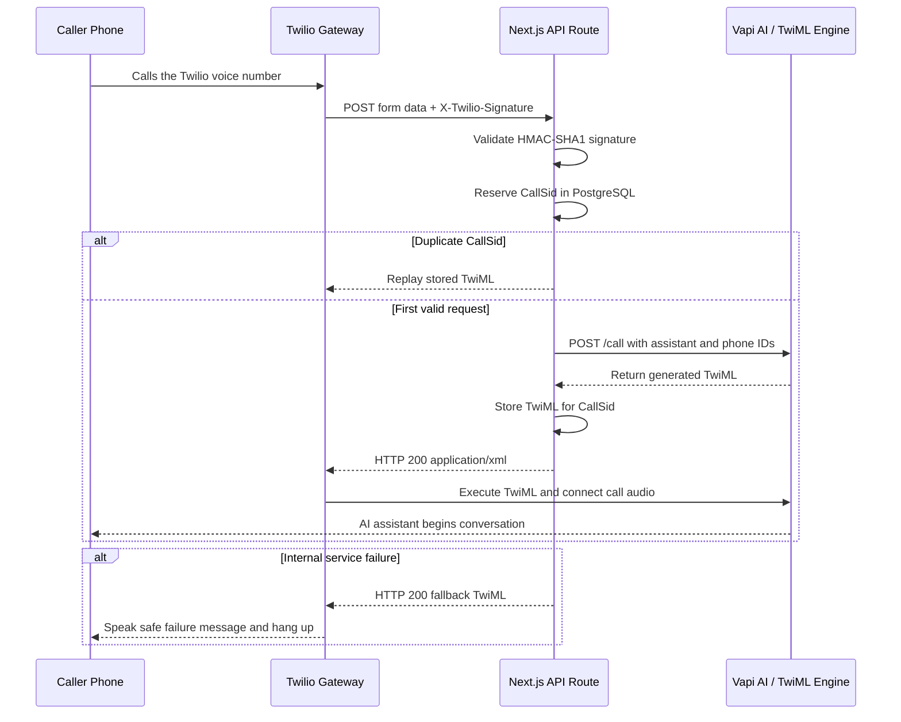

# Live Twilio/Vapi Webhook Handler Audit

## Route

`POST /api/webhooks/twilio/voice`

Implementation:
`src/app/api/webhooks/twilio/voice/route.ts`

## 1. Sequence Diagram and Step Trace



Step trace:

1. The caller dials the Twilio voice number.
2. Twilio sends an HTTPS form-encoded `POST` request to the Next.js
   webhook.
3. The route reads `X-Twilio-Signature` and validates it using the exact
   public webhook URL, form fields, and `TWILIO_AUTH_TOKEN`.
4. The route validates `CallSid`.
5. PostgreSQL reserves `CallSid` before Vapi is contacted.
6. A repeated `CallSid` receives the previously stored TwiML rather
   than creating another Vapi call.
7. For a first request, the route calls `https://api.vapi.ai/call`
   using server-only Vapi credentials.
8. Vapi returns TwiML that connects Twilio audio to the published
   assistant.
9. The route validates and stores that TwiML, then returns it with HTTP
   `200` and `Content-Type: text/xml`.
10. Internal failures return safe fallback TwiML so the caller hears a
    useful message.

## 2. Cryptographic Signature Validation

Exact handler code:

```ts
const signature = request.headers.get(
  "x-twilio-signature",
);

const signatureIsValid =
  signature !== null &&
  twilio.validateRequest(
    authToken,
    signature,
    webhookUrl,
    parameters,
  );

if (!signatureIsValid) {
  return new NextResponse(
    "Invalid Twilio signature.",
    {
      status: 403,
      headers: {
        "Content-Type":
          "text/plain; charset=utf-8",
        "Cache-Control": "no-store",
      },
    },
  );
}
```

The verified HTTP header is:

```text
X-Twilio-Signature
```

HTTP header names are case-insensitive; Next.js exposes it through the
lowercase lookup `x-twilio-signature`.

The HMAC-SHA1 computation uses the server-only value:

```text
TWILIO_AUTH_TOKEN
```

from `.env.local` locally and Vercel Environment Variables in the
deployed application. The validator also uses the exact canonical URL
from `TWILIO_VOICE_WEBHOOK_URL` and all form parameters.

A failed validation returns:

```http
HTTP/1.1 403 Forbidden
Content-Type: text/plain; charset=utf-8
Cache-Control: no-store

Invalid Twilio signature.
```

## 3. Idempotency Enforcement

Twilio supplies the unique call identifier:

```text
CallSid
```

The PostgreSQL table `public.twilio_webhook_events` uses `call_sid` as
its primary key. The handler first inserts the `CallSid` with safe
fallback TwiML before contacting Vapi.

If Twilio retries the same webhook, PostgreSQL returns unique-constraint
code `23505`. The route reads and replays the stored `response_xml`
instead of executing a second Vapi call.

Exact duplicate branch:

```ts
if (insertError?.code === "23505") {
  const {
    data: existingEvent,
    error: readError,
  } = await supabase
    .from("twilio_webhook_events")
    .select("response_xml")
    .eq("call_sid", callSid)
    .single();

  if (readError || !existingEvent) {
    throw new Error(
      "Duplicate response could not be read.",
    );
  }

  console.info("twilio_voice_webhook", {
    callSid: maskCallSid(callSid),
    from: maskPhoneNumber(caller),
    outcome: "duplicate-replayed",
  });

  return twimlResponse(
    existingEvent.response_xml,
  );
}
```

Reserving the identifier before the Vapi request prevents network
retries from creating multiple AI calls.

## 4. PII and Safe Logging Audit

Accepted-request logging:

```ts
console.info("twilio_voice_webhook", {
  callSid: maskCallSid(callSid),
  from: maskPhoneNumber(caller),
  outcome: "accepted",
});
```

Failure logging:

```ts
console.error(
  "twilio_voice_webhook_error",
  {
    callSid: maskCallSid(callSid),
    from: maskPhoneNumber(caller),
    outcome: "fallback-returned",
  },
);
```

A caller such as `+1 (213) 555-1234` is logged only as:

```text
***-***-1234
```

A complete CallSid is reduced to a form such as:

```text
CA…111111
```

The route does not log request form data, full phone numbers,
transcripts, assistant messages, the Vapi response, API keys, or Auth
Tokens. The idempotency table stores only `CallSid`, event type, TwiML,
and timestamp; it does not store `From` or transcript content.

## 5. Safe Error Handling and Fallback TwiML

If Supabase, Vapi, configuration, or response validation fails, the
handler returns HTTP `200` with `Content-Type: text/xml`.

Raw fallback payload:

```xml
<?xml version="1.0" encoding="UTF-8"?>
<Response>
  <Say>We are temporarily unable to connect your call. Please try again later.</Say>
  <Hangup/>
</Response>
```

The actual serialized constant is:

```ts
export const FALLBACK_TWIML =
  '<?xml version="1.0" encoding="UTF-8"?>' +
  "<Response>" +
  "<Say>We are temporarily unable to connect your call. " +
  "Please try again later.</Say>" +
  "<Hangup/>" +
  "</Response>";
```

Returning valid TwiML with HTTP `200` ensures Twilio speaks the safe
message and ends the call cleanly rather than exposing an exception or
leaving the caller on a dead line.

## Verification Evidence

- Genuine Twilio signature accepted
- Changed signed request rejected
- Phone number and CallSid masking tested
- Invalid CallSid rejected
- Valid Vapi TwiML extracted
- Malformed and unsafe TwiML rejected
- Exact fallback TwiML asserted
- 31 automated tests passed
- ESLint passed
- Next.js production build passed